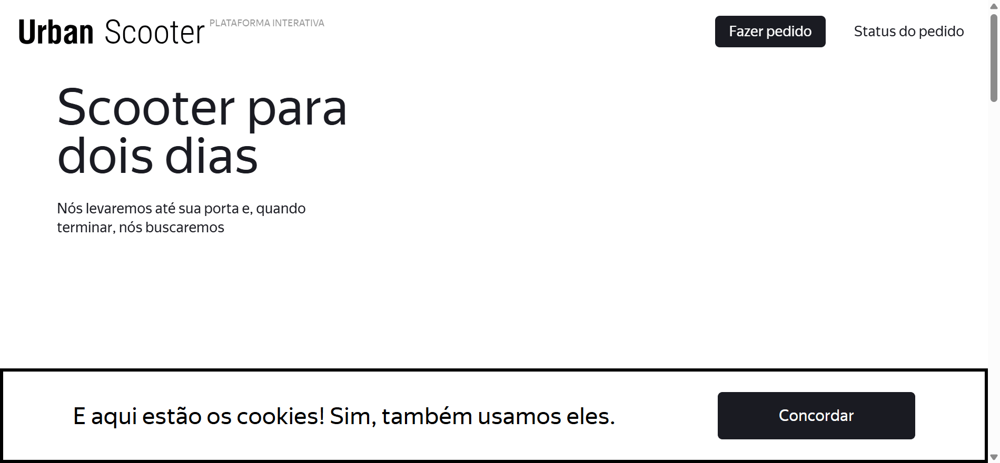

> Detailed setup, per-test commands, GIF walkthroughs, and the Portuguese guide. The short English overview is in [../README.md](../README.md).

# Urban Scooter — QA test automation

QA automation project for the Urban Scooter application, based on the cases in `Vinicius Silva_QA32_SPT9.xlsx`. The Web suite uses Python, pytest, Selenium WebDriver, and the Page Object Model (POM). API and Android tests are also present in the repository and are being validated in separate stages.

## Goal and coverage

Validate the main scooter rental flows, from the landing page and order form to order tracking, while preparing the API and Android suites.

| Area | Coverage |
| --- | --- |
| Web | Layout, form validation, order creation, and order status lookup. |
| API | Courier cases documented in `tests/api/test_couriers.py` (API1–API31). |
| Android | Tests organized under `tests/mobile/`, using Appium and UiAutomator2. |

## Technologies and practices

- Python and pytest to organize and run test cases.
- Selenium WebDriver, explicit waits, and Page Object Model (POM) for Web tests.
- Parameterized cases for valid, invalid, and boundary values.
- JUnit XML reports and visual evidence in GIF/MP4 format.
- Python `urllib` for API requests.
- Appium and UiAutomator2 for Android automation.

## Web test demonstrations

These GIFs show selected interactions captured by the Web tests. Each is a sequence of browser checkpoints, not a continuous screen recording. Follow the setup instructions below before running the commands.

### 1. Station autocomplete

<p align="center">
  
</p>

**What the test does:** Enters a station name, waits for matching suggestions, and selects one before moving to the next form step.

**Pytest test:** `test_station_suggestion_can_be_selected`

**Run this test:**

```powershell
python -m pytest "tests/web/scenarios/test_order_form.py::test_station_suggestion_can_be_selected" -v --junitxml=reports/station-autocomplete.xml
```

### 2. Rental period selection

<p align="center">
  
</p>

**What the test does:** Opens the rental-period control and checks that a supported duration can be selected.

**Pytest test:** `test_rental_period_has_supported_choices`

**Run this test:**

```powershell
python -m pytest "tests/web/scenarios/test_order_flow.py::test_rental_period_has_supported_choices" -v --junitxml=reports/rental-period.xml
```

### 3. Scooter color selection

<p align="center">
  
</p>

**What the test does:** Selects an available scooter color in the rental form.

**Pytest test:** `test_optional_scooter_color_can_be_selected`

**Run this test:**

```powershell
python -m pytest "tests/web/scenarios/test_order_flow.py::test_optional_scooter_color_can_be_selected" -v --junitxml=reports/scooter-color.xml
```

### 4. Preserving details when returning to the previous step

<p align="center">
  
</p>

**What the test does:** Enters order details, advances to the rental step, returns to the previous step, and checks that the entered values are still present.

**Pytest test:** `test_details_are_preserved_when_returning_to_previous_step`

**Run this test:**

```powershell
python -m pytest "tests/web/scenarios/test_order_flow.py::test_details_are_preserved_when_returning_to_previous_step" -v --junitxml=reports/preserve-details.xml
```

The full set of per-test GIFs and MP4s is generated under `reports/media/`. The four examples above are stored in `docs/media/` so they remain visible on GitHub; `reports/` is generated locally and ignored by Git.

## Project structure

```text
.
├── docs/media/       # GIFs shown in this README
├── postman/          # API collection and environment
├── tests/
│   ├── api/           # API tests
│   ├── mobile/        # Android tests
│   └── web/
│       ├── pages/     # Page Objects and UI interactions
│       └── scenarios/ # Web scenarios grouped by flow
├── reports/           # Locally generated reports and evidence
├── pytest.ini
└── Vinicius Silva_QA32_SPT9.xlsx  # Test case workbook
```

The setup and execution guide below covers the Web suite, which can be run separately from the API and Android stages.

## Web suite: setup and execution

The commands below use Windows PowerShell. Run them from the repository root.

### 1. Check Python and create a virtual environment

Check that Python is installed:

```powershell
py --version
```

Create the environment once. If `.venv` already exists, skip this command:

```powershell
py -m venv .venv
```

Activate it:

```powershell
.\.venv\Scripts\Activate.ps1
```

When it is active, `.venv` appears at the beginning of the PowerShell prompt. If the execution policy blocks activation, allow scripts only for the current terminal session and try again:

```powershell
Set-ExecutionPolicy -Scope Process -ExecutionPolicy Bypass
.\.venv\Scripts\Activate.ps1
```

To leave the virtual environment:

```powershell
deactivate
```

### 2. Install Web dependencies

With the virtual environment active, install pytest, Selenium, and the libraries used to create GIF/MP4 evidence:

```powershell
python -m pip install --upgrade pip
python -m pip install pytest selenium pillow imageio-ffmpeg
```

Install and open Google Chrome. Selenium Manager will try to locate or download a compatible ChromeDriver automatically.

If Selenium Manager cannot obtain a driver, the fixture tries the newest driver in the Selenium cache. You can also set `URBAN_CHROMEDRIVER` to a ChromeDriver compatible with your installed Chrome:

```powershell
$env:URBAN_CHROMEDRIVER = "C:\path\to\chromedriver.exe"
```

### 3. Configure the test stand

Set the Web application URL. The fixture keeps the interface in Portuguese even when the URL already contains `?lng=pt`. Test-stand URLs may change; replace this value with the currently active URL when needed.

```powershell
$env:URBAN_WEB_URL = "https://cnt-21e647cd-cf6f-4526-b07e-1d34f0ed0f44.containerhub.tripleten-services.com/?lng=pt"
```

Optionally run Chrome without opening a window:

```powershell
$env:URBAN_HEADLESS = "true"
```

### 4. List and run selected test cases

List the tests pytest collected, including each parameterized variation:

```powershell
python -m pytest --collect-only -q tests/web
```

Run one test using its node ID from that list:

```powershell
python -m pytest "tests/web/scenarios/test_layout.py::test_order_button_is_visible_and_enabled" -v
```

To see the node IDs for a parameterized test:

```powershell
python -m pytest --collect-only -q tests/web/scenarios/test_order_form.py
```

Copy the complete node ID, including the part in square brackets, to run one variation.

Before using the commands that write XML reports, create the reports folder once:

```powershell
New-Item -ItemType Directory -Force reports | Out-Null
```

### 5. Run every Web case separately and save its results

This script collects full node IDs and starts pytest once per case. Each run creates:

- A `.log` file with detailed terminal output.
- A JUnit `.xml` file with the result, duration, failure, or skipped status.
- A GIF and an MP4 under `reports/media/`, built from interface checkpoints rather than continuous screen recording.

```powershell
New-Item -ItemType Directory -Force reports | Out-Null

$collectedTests = python -m pytest --collect-only -q tests/web
if ($LASTEXITCODE -ne 0) {
    throw "Failed to collect Web tests. Check the dependencies and output above."
}

$testNodes = $collectedTests | Where-Object { $_ -match '^tests[\\/].+::test_' }
if (-not $testNodes) {
    throw "No Web test cases were found. Check that the virtual environment is active and dependencies are installed."
}

$failedTests = @()
foreach ($testNode in $testNodes) {
    $reportName = $testNode -replace '[^A-Za-z0-9_.-]', '_'
    Write-Host "`nRunning: $testNode"

    python -m pytest "$testNode" -v "--junitxml=reports/$reportName.xml" 2>&1 |
        Tee-Object -FilePath "reports/$reportName.log"

    if ($LASTEXITCODE -ne 0) {
        $failedTests += $testNode
    }
}

if ($failedTests.Count -gt 0) {
    Write-Host "`nFailed test cases:"
    $failedTests | ForEach-Object { Write-Host " - $_" }
    throw "$($failedTests.Count) test case(s) failed. See reports/."
}

Write-Host "`nAll collected cases finished without failures. See reports/ for logs and XML files."
```

Parameterized cases appear as separate node IDs and run individually in the loop. Order states are prepared by the suite. If the test stand is unavailable, the tests fail with a connection error instead of being skipped.

### 6. Run a whole file or the complete Web suite

Run each group separately:

```powershell
python -m pytest tests/web/scenarios/test_layout.py -v --junitxml=reports/layout.xml
python -m pytest tests/web/scenarios/test_order_form.py -v --junitxml=reports/order-form.xml
python -m pytest tests/web/scenarios/test_order_flow.py -v --junitxml=reports/order-flow.xml
python -m pytest tests/web/scenarios/test_order_status.py -v --junitxml=reports/order-status.xml
```

Run the complete Web suite in one command:

```powershell
python -m pytest tests/web -v --junitxml=reports/web-suite.xml
```

## Test data and expected results

Order-status cases create their own orders on the test stand. Courier acceptance and arrival scenarios create a temporary courier through the API and remove it, together with associated orders, after the test. USBR31, USBR35, and USBR44 also create orders. Use the test stand only.

Some validation data has defects already recorded in the workbook: USBR13, USBR17, USBR21, USBR24, and USBR25. These parameters are marked `XFAIL` while the application keeps the reported behavior. The FAQ also has a reported defect: its answer does not close when clicked a second time, so that case is marked `XFAIL`. `XFAIL` means the expected assertion failed; `XPASS` means the application may have been fixed and the marker should be reviewed.

## Web test modules

- `tests/web/conftest.py`: per-test Chrome fixtures and URL setup.
- `tests/web/pages/urban_scooter_page.py`: Page Objects, locators, interactions, and explicit waits.
- `tests/web/data.py`: test-stand URL and shared test data.
- `tests/web/evidence.py`: captures checkpoints and creates per-case GIF/MP4 evidence.
- `tests/web/scenarios/test_layout.py`: USBR1–USBR5.
- `tests/web/scenarios/test_order_form.py`: USBR6–USBR30 and USBR48.
- `tests/web/scenarios/test_order_flow.py`: USBR31–USBR38.
- `tests/web/scenarios/test_order_status.py`: USBR39–USBR47.

## API and Android

API and Android tests are under `tests/api/` and `tests/mobile/`; the Web commands above do not run them. The current API base URL is `https://cnt-21e647cd-cf6f-4526-b07e-1d34f0ed0f44.containerhub.tripleten-services.com`, and the API documentation is at `https://cnt-21e647cd-cf6f-4526-b07e-1d34f0ed0f44.containerhub.tripleten-services.com/docs/pt/`. Configure `URBAN_API_BASE_URL` with the active base URL before running API tests.

Android tests require Appium, UiAutomator2, and a configured device or emulator. Check the `conftest.py` files and confirm the app package/activity settings before running those tests.

___________________________________________________


# Urban Scooter — automação de QA

Projeto de automação de QA para o aplicativo Urban Scooter, baseado nos casos da planilha `Vinicius Silva_QA32_SPT9.xlsx`. A suíte Web usa Python, pytest, Selenium WebDriver e o padrão Page Object Model (POM). O repositório também contém testes de API e Android, cujas etapas de execução e validação estão em andamento.

## Objetivo e cobertura

Validar os principais fluxos de aluguel de patinetes, desde a página inicial até o acompanhamento de pedidos, além de preparar a automação de API e Android.

| Área | Cobertura |
| --- | --- |
| Web | Layout, formulário e validações, criação de pedido e consulta de status. |
| API | Casos de entregadores documentados em `tests/api/test_couriers.py` (API1–API31). |
| Android | Casos organizados em `tests/mobile/`, com Appium e UiAutomator2. |

## Tecnologias e práticas

- Python e pytest para organizar e executar os casos.
- Selenium WebDriver, waits explícitos e Page Object Model (POM) na suíte Web.
- Testes parametrizados para cobrir valores válidos, inválidos e limites.
- Relatórios JUnit XML e evidências visuais em GIF/MP4.
- `urllib` para as solicitações HTTP da suíte de API.
- Appium e UiAutomator2 para a automação Android.

## Exemplos de testes Web

Os GIFs estão na seção em inglês acima. Abaixo estão os mesmos cenários descritos em português, com o nome do teste e o comando para executá-lo.

### 1. Busca e seleção de estação

O teste digita o nome de uma estação, aguarda as sugestões correspondentes, seleciona uma delas e avança no formulário.

**Teste pytest:** `test_station_suggestion_can_be_selected`

```powershell
python -m pytest "tests/web/scenarios/test_order_form.py::test_station_suggestion_can_be_selected" -v --junitxml=reports/station-autocomplete.xml
```

### 2. Seleção do período de aluguel

O teste abre as opções de período e verifica que é possível selecionar uma duração aceita.

**Teste pytest:** `test_rental_period_has_supported_choices`

```powershell
python -m pytest "tests/web/scenarios/test_order_flow.py::test_rental_period_has_supported_choices" -v --junitxml=reports/rental-period.xml
```

### 3. Seleção da cor do patinete

O teste seleciona uma das cores disponíveis no formulário de aluguel.

**Teste pytest:** `test_optional_scooter_color_can_be_selected`

```powershell
python -m pytest "tests/web/scenarios/test_order_flow.py::test_optional_scooter_color_can_be_selected" -v --junitxml=reports/scooter-color.xml
```

### 4. Preservação dos dados ao voltar à etapa anterior

O teste preenche os dados do pedido, avança para a etapa de aluguel, volta e confere se os valores digitados continuam preenchidos.

**Teste pytest:** `test_details_are_preserved_when_returning_to_previous_step`

```powershell
python -m pytest "tests/web/scenarios/test_order_flow.py::test_details_are_preserved_when_returning_to_previous_step" -v --junitxml=reports/preserve-details.xml
```

Os GIFs completos gerados por caso ficam em `reports/media/`. Os quatro exemplos da seção em inglês foram copiados para `docs/media/` para que também apareçam na página do projeto no GitHub.

## Organização do projeto

```text
.
├── docs/media/       # GIFs selecionados para este README
├── postman/          # Coleção e ambiente da API
├── tests/
│   ├── api/           # Testes de API
│   ├── mobile/        # Testes Android
│   └── web/
│       ├── pages/     # Page Objects e interações da interface
│       └── scenarios/ # Cenários Web por fluxo
├── reports/           # Relatórios e evidências gerados localmente
├── pytest.ini
└── Vinicius Silva_QA32_SPT9.xlsx  # Casos de teste de referência
```

**O passo a passo a seguir cobre a suíte Web**, que pode ser executada independentemente das etapas de API e Android.

## Suíte Web: instalação e execução

Os comandos abaixo usam Windows PowerShell. Execute-os a partir da pasta raiz do repositório.

### 1. Verifique o Python e crie o ambiente virtual

Confira se o Python está instalado:

```powershell
py --version
```

Crie o ambiente virtual uma vez. Se a pasta `.venv` já existir, pule a criação:

```powershell
py -m venv .venv
```

Ative o ambiente:

```powershell
.\.venv\Scripts\Activate.ps1
```

Quando ativo, o nome `.venv` aparece no início do prompt do PowerShell. Se a política de execução bloquear a ativação, libere scripts apenas para a janela atual e tente de novo:

```powershell
Set-ExecutionPolicy -Scope Process -ExecutionPolicy Bypass
.\.venv\Scripts\Activate.ps1
```

Para sair do ambiente virtual ao terminar:

```powershell
deactivate
```

### 2. Instale as dependências Web

Com o ambiente virtual ativo, instale pytest e Selenium:

```powershell
python -m pip install --upgrade pip
python -m pip install pytest selenium pillow imageio-ffmpeg
```

Instale e abra o Google Chrome. O Selenium Manager tenta localizar ou baixar um ChromeDriver compatível automaticamente.

Se o Selenium Manager não conseguir obter o driver, a fixture tenta usar a versão mais recente encontrada no cache do Selenium. Você também pode configurar `URBAN_CHROMEDRIVER` manualmente com um driver compatível com o Chrome instalado. Exemplo para esta máquina, se o arquivo ainda estiver presente:

```powershell
$env:URBAN_CHROMEDRIVER = "C:\path\to\chromedriver.exe"
```

### 3. Configure a estande de teste

Configure a URL da aplicação Web. O fixture mantém o idioma português mesmo quando a URL já contém `?lng=pt`:

```powershell
$env:URBAN_WEB_URL = "https://cnt-21e647cd-cf6f-4526-b07e-1d34f0ed0f44.containerhub.tripleten-services.com/?lng=pt"
```

Opcionalmente, execute o Chrome sem abrir uma janela:

```powershell
$env:URBAN_HEADLESS = "true"
```

### 4. Confira quais casos serão executados

Liste os casos que pytest encontrou, incluindo cada variação parametrizada:

```powershell
python -m pytest --collect-only -q tests/web
```

Um caso específico pode ser executado usando o identificador exibido nessa lista:

```powershell
python -m pytest "tests/web/scenarios/test_layout.py::test_cookie_consent_dismisses_banner" -v
```

Para ver os identificadores das variações de um teste parametrizado:

```powershell
python -m pytest --collect-only -q tests/web/scenarios/test_order_form.py
```

Copie o identificador completo desejado, incluindo o trecho entre colchetes, para executar somente aquela variação.

### 5. Execute todos os casos Web, um por vez, e documente os resultados

O script abaixo coleta os identificadores completos e chama pytest separadamente para cada caso. Cada execução gera:

- Um arquivo `.log` com a saída detalhada do terminal.
- Um arquivo `.xml` em formato JUnit com o resultado estruturado, duração, falha ou status de ignorado.
- Um GIF animado e um vídeo MP4 em `reports/media/`, montados com capturas das etapas da interface (não é gravação contínua da tela).

Os arquivos ficam na pasta `reports/`.

```powershell
New-Item -ItemType Directory -Force reports | Out-Null

$collectedTests = python -m pytest --collect-only -q tests/web
if ($LASTEXITCODE -ne 0) {
    throw "Falha ao coletar os testes Web. Confira as dependências e a saída acima."
}

$testNodes = $collectedTests | Where-Object { $_ -match '^tests[\\/].+::test_' }
if (-not $testNodes) {
    throw "Nenhum caso Web foi encontrado. Confira se o venv está ativo e as dependências instaladas."
}

$failedTests = @()
foreach ($testNode in $testNodes) {
    $reportName = $testNode -replace '[^A-Za-z0-9_.-]', '_'
    Write-Host "`nExecutando: $testNode"

    python -m pytest "$testNode" -v "--junitxml=reports/$reportName.xml" 2>&1 |
        Tee-Object -FilePath "reports/$reportName.log"

    if ($LASTEXITCODE -ne 0) {
        $failedTests += $testNode
    }
}

if ($failedTests.Count -gt 0) {
    Write-Host "`nCasos com falha:"
    $failedTests | ForEach-Object { Write-Host " - $_" }
    throw "A execução terminou com $($failedTests.Count) caso(s) com falha. Consulte reports/."
}

Write-Host "`nTodos os casos coletados terminaram sem falha. Consulte reports/ para logs e XMLs."
```

Casos parametrizados aparecem como identificadores separados na coleta e são executados individualmente pelo loop. Os estados dos pedidos são preparados automaticamente pela suíte; se a estande estiver indisponível, o teste falha com o erro de conexão em vez de ser ignorado.

### 6. Execute um arquivo inteiro ou a suíte toda em uma chamada

Para rodar cada grupo sem separar os casos individuais, use:

```powershell
python -m pytest tests/web/scenarios/test_layout.py -v --junitxml=reports/layout.xml
python -m pytest tests/web/scenarios/test_order_form.py -v --junitxml=reports/order-form.xml
python -m pytest tests/web/scenarios/test_order_flow.py -v --junitxml=reports/order-flow.xml
python -m pytest tests/web/scenarios/test_order_status.py -v --junitxml=reports/order-status.xml
```

Para rodar a suíte Web inteira em uma chamada:

```powershell
python -m pytest tests/web -v --junitxml=reports/web-suite.xml
```

## Dados e resultados esperados

Os casos de status criam seus próprios pedidos na estande. Os cenários de aceite e chegada criam um entregador temporário pela API e o removem ao final, incluindo os pedidos associados. USBR31, USBR35 e USBR44 também criam pedidos. Use exclusivamente a estande de teste.

Alguns dados de validação têm defeitos já registrados na planilha: USBR13, USBR17, USBR21, USBR24 e USBR25. Esses parâmetros estão marcados como `XFAIL` enquanto a aplicação mantiver o comportamento reportado. O FAQ também tem um defeito reportado: a resposta não fecha ao clicar novamente; esse caso fica como `XFAIL`. `XFAIL` significa que a asserção do requisito falhou como previsto; `XPASS` indica que a aplicação pode ter sido corrigida e a marcação deve ser reavaliada. Isso mantém os defeitos visíveis sem contá-los como testes aprovados.

## Organização dos testes Web

- `tests/web/conftest.py`: fixture do Chrome isolada por teste e configuração da URL.
- `tests/web/pages/urban_scooter_page.py`: Page Objects, locators, interações e waits explícitos.
- `tests/web/data.py`: URL da estande e dados reutilizados entre cenários.
- `tests/web/evidence.py`: captura checkpoints e gera GIF/MP4 por caso.
- `tests/web/scenarios/test_layout.py`: USBR1–USBR5.
- `tests/web/scenarios/test_order_form.py`: USBR6–USBR30 e USBR48.
- `tests/web/scenarios/test_order_flow.py`: USBR31–USBR38.
- `tests/web/scenarios/test_order_status.py`: USBR39–USBR47.

## API e Android

Os testes de API e Android estão em `tests/api/` e `tests/mobile/`, respectivamente, e não são executados pelos comandos Web acima. A URL-base atual da API é `https://cnt-21e647cd-cf6f-4526-b07e-1d34f0ed0f44.containerhub.tripleten-services.com`; a documentação está em `https://cnt-21e647cd-cf6f-4526-b07e-1d34f0ed0f44.containerhub.tripleten-services.com/docs/pt/`. Para executar a suíte de API, configure `URBAN_API_BASE_URL` com a URL-base ativa. Android requer Appium, UiAutomator2 e um dispositivo ou emulador configurado. Confira os respectivos arquivos `conftest.py` e valide as configurações do ambiente antes de executar essas suítes.
